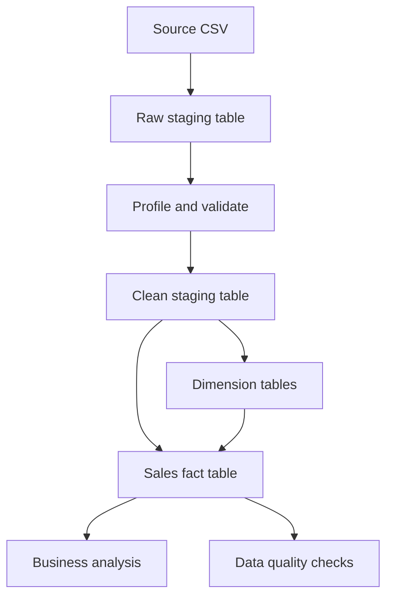

# Retail Sales ETL & Data Processing Pipeline

An end-to-end **SQL ETL and data warehousing portfolio project** built with MySQL 8.0+. The pipeline ingests raw retail transactions from CSV, profiles and validates the data, removes duplicate and invalid records, builds a dimensional data mart, and answers business questions with analytical SQL.

> **Dataset note:** The included CSV is synthetic sample data created for learning and portfolio demonstration. It is not real company or customer data.

## Project highlights

- Loaded a denormalized CSV file into a raw staging table using `LOAD DATA LOCAL INFILE`.
- Profiled source data and checked missing business keys and duplicate order-line IDs.
- Parsed and typed source values, handled the source's `DD-MM-YYYY` date format, and filtered invalid records.
- Calculated net revenue, total cost, gross profit, and gross margin.
- Designed a star schema with customer, product, and date dimensions plus a sales fact table.
- Wrote business analysis queries for KPIs, monthly trends, category performance, top customers, sales channels, and products.
- Added data-quality checks and row-count / financial reconciliation queries.

## Technology stack

| Area | Tools |
|---|---|
| Database | MySQL 8.0+ |
| Query language | SQL |
| Source data | CSV |
| Database client | MySQL Workbench |

## Repository structure

```text
retail-sales-etl/
├── data/
│   └── raw_retail_sales.csv
├── docs/
│   └── DATA_MODEL.md
├── sql/
│   ├── 01_create_database.sql
│   ├── 02_create_staging.sql
│   ├── 03_load_csv.sql
│   ├── 04_clean_and_validate.sql
│   ├── 05_create_data_mart.sql
│   ├── 06_load_data_mart.sql
│   ├── 07_business_analysis.sql
│   └── 08_quality_checks.sql
├── .gitignore
├── LICENSE
└── README.md
```

## Data pipeline



## Data model

The data mart follows a **star schema**:

- `dim_customer`: customer attributes and customer surrogate key.
- `dim_product`: product attributes and product surrogate key.
- `dim_date`: calendar attributes and `YYYYMMDD` date key.
- `fact_sales`: transaction-line measures and foreign keys to the dimensions.

See [`docs/DATA_MODEL.md`](docs/DATA_MODEL.md) for the ER diagram and table details.

## Setup and execution

### 1. Prerequisites

- MySQL Server 8.0 or later.
- MySQL Workbench (or another MySQL client).
- The repository cloned or downloaded to your computer.

### 2. Clone the repository

```bash
git clone https://github.com/<your-username>/retail-sales-etl.git
cd retail-sales-etl
```

### 3. Run the SQL scripts in order

Open MySQL Workbench, connect to your local MySQL server, then execute:

1. `sql/01_create_database.sql` — create and select the database.
2. `sql/02_create_staging.sql` — create the raw staging table.
3. `sql/03_load_csv.sql` — load the CSV file.
4. `sql/04_clean_and_validate.sql` — profile, parse, deduplicate, and validate.
5. `sql/05_create_data_mart.sql` — create the star-schema tables.
6. `sql/06_load_data_mart.sql` — load dimensions and fact records.
7. `sql/07_business_analysis.sql` — run business analysis.
8. `sql/08_quality_checks.sql` — run quality and reconciliation checks.

**CSV path configuration:** In `sql/03_load_csv.sql`, replace the placeholder path with the absolute path to `data/raw_retail_sales.csv` on your computer. Use forward slashes in Windows paths, for example:

```sql
LOAD DATA LOCAL INFILE 'C:/Users/YourName/Projects/retail-sales-etl/data/raw_retail_sales.csv'
```

If `LOCAL INFILE` is disabled, enable it in both your MySQL client and server configuration, or use MySQL Workbench's **Table Data Import Wizard** to import the CSV into `stg_retail_sales_raw`. If you use the wizard, skip the `LOAD DATA` statement in script 03. The supplied CSV uses Windows CRLF line endings, so the load script uses `LINES TERMINATED BY '\r\n'`. If you re-export the CSV with LF-only line endings, change this clause to `LINES TERMINATED BY '\n'`. The first row is a header; do not delete it manually.

### 4. Verify the output

After script 06, confirm that dimension and fact tables contain rows. Then run scripts 07 and 08. The quality-check queries should report no duplicate fact keys, invalid fact measures, unmatched dimension records, or calculation mismatches. The staging-to-fact row difference should be zero.

> **Rerunning:** Scripts 02 and 05 drop and recreate their respective tables. This is a portfolio/demo workflow and will remove existing data in those tables. Script 06 clears and reloads the data mart from the clean staging table.

## ETL workflow

| Stage | What happens |
|---|---|
| Extract | Load the source CSV into `stg_retail_sales_raw`. |
| Profile | Inspect row counts, missing identifiers, duplicates, and invalid values. |
| Transform | Parse dates and numeric values, trim text, deduplicate order lines, reject invalid records, and calculate financial measures. |
| Load | Populate `dim_customer`, `dim_product`, `dim_date`, and `fact_sales`. |
| Analyze | Query sales KPIs, monthly trends, category performance, customers, products, and channels. |
| Validate | Reconcile row counts and verify keys and financial calculations. |

## Business definitions

| Metric | Definition |
|---|---|
| Gross sales | `quantity × unit_price` |
| Net revenue | `gross sales × (1 − discount_pct)` |
| Total cost | `quantity × unit_cost` |
| Gross profit | `net revenue − total_cost` |
| Gross margin % | `(gross_profit ÷ net_revenue) × 100` |

`discount_pct` is stored as a decimal fraction (for example, `0.15` represents 15%).

## Dataset quality scenarios

The supplied sample CSV contains 256 source rows and deliberately includes:
- One duplicated `order_line_id`.
- One record with zero quantity.
- One record with a negative unit price.
- One record with an invalid date string.

The cleaning step is expected to retain valid, unique transaction lines and exclude these invalid rows.

## Skills demonstrated

SQL querying · ETL design · Data cleaning · Data validation · CTEs · Window functions · Aggregations · Star schema · Fact and dimension tables · KPI analysis · Data reconciliation

## Author

**Peeyush Thakre**  
GitHub: [peeyush-thakre](https://github.com/peeyush-thakre)

---

If you use this project in your resume or portfolio, describe only the steps you have personally executed, tested, and can explain.
