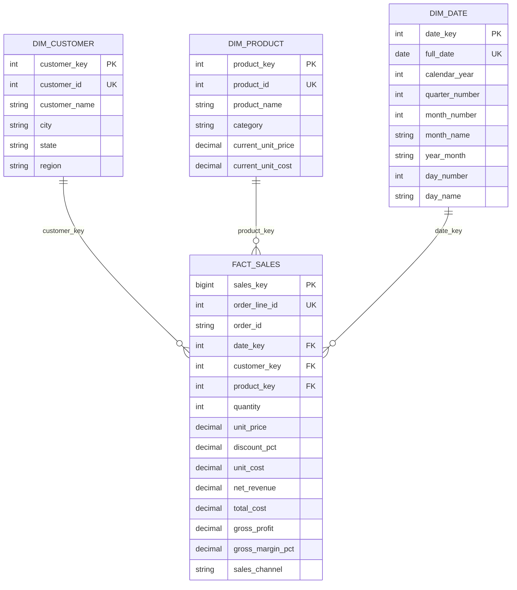

# Data Mart Data Model

The project uses a dimensional **star schema**. `fact_sales` stores one row per valid order line and references the customer, product, and date dimensions through surrogate keys.

## Table grain

- **Fact table grain:** one row per unique `order_line_id`.
- **Customer dimension grain:** one row per `customer_id`.
- **Product dimension grain:** one row per `product_id`.
- **Date dimension grain:** one row per calendar date present in the cleaned transactions.

## Measures

- `net_revenue`: quantity × unit price × (1 − discount fraction).
- `total_cost`: quantity × unit cost.
- `gross_profit`: net revenue − total cost.
- `gross_margin_pct`: gross profit ÷ net revenue × 100.

## Design note

The product dimension stores the maximum observed unit price and cost as current descriptive attributes. Transaction-level price and cost are also retained in `fact_sales`, preserving the values used for each transaction's financial calculations.
